<p align="center"></p>

# SimpleClip for Linux

SimpleClip keeps the last 30 seconds (or 15 s, 45 s, 1 min, 2 min, 5 min) of your screen in memory. When
something good happens you press a shortcut and those seconds are written to an MP4. There is no
record button and nothing to start before you play.

This is the Linux version of [SimpleClip for Windows](https://github.com/whoevenisxeno/simpleclip-windows):
the same app, the same look, the same features, on Wayland and PipeWire. A background service, a small
app for browsing and trimming clips, and a command line. I'm not trying to replace ShadowPlay or Medal. I
wanted something small that does one job and does not need an account.

## What it does

- **Always-on replay buffer.** The screen through the desktop's ScreenCast portal and PipeWire, desktop
  sound and an optional microphone through PipeWire, encoded on the GPU the whole time and kept in RAM.
  Your desktop asks which screen to share once, then remembers.
- **Shortcuts.** `Alt+F10` saves a clip, `Alt+F9` saves a screenshot, `Alt+F8` brings the SimpleClip
  window up (press it again to put it away). All three can be changed in Settings. They are registered
  with the compositor, so nothing needs root: managed binds on Hyprland, the GlobalShortcuts portal on
  KDE and GNOME.
- **Hardware encoding.** VA-API (AMD, Intel), then NVENC (NVIDIA), then software x264, and it uses the
  first one that works.
- **Audio.** Game and app sound, plus an optional microphone. The mic can be mixed into one track or
  kept on its own track so you can edit your voice separately.
- **Save card.** A small card slides in when a clip is saved, with its size, resolution, frame rate and
  encoder, or a minimal one-line version if you prefer. You choose the corner (or the center), whether
  it slides, and the sound (a camera shutter by default, or your own WAV file, or none).
- **Discord status.** While SimpleClip is recording and you are in a game, your Discord profile shows
  the game and how long you have been playing and clipping. Only games: a browser, the desktop or any
  other program shows nothing. A game is recognised as a Steam game (including Proton), by its Heroic,
  Lutris, GOG or itch folder, by being a well-known title, or by being full screen. It goes through the
  Discord app on your PC, not over the network from SimpleClip, and it is on by default. Turn it off in
  Settings > General.
- **Clip gallery.** Previews, search, and grouping by game, date, folder or bookmark.
- **Rename, folders, bookmarks, notes.** All inside the app. Bookmarks are labels you create and colour
  yourself. Nothing is ever bookmarked automatically.
- **Trim with a live player.** The player is built into the app. It plays and loops only the part you
  selected, and follows the handles while you drag them, so you see the cut as you make it. Then either
  keep the original and make a trimmed copy, or replace the original (it goes to the trash, not deleted
  for good). Trimming copies the stream without re-encoding, so it is instant and lossless, but cuts
  land on keyframes.
- **Trimmed clips stay separate.** They get their own view and a small badge, and they are left out of
  the normal clip list and the Recent row on Home.
- **Share a clip.** "Copy file" puts the clip on the clipboard, so pasting into Discord or a chat
  attaches it. "Compress for Discord" makes a smaller copy that fits 10, 25 or 50 MB, scaling the
  picture down only as far as it must. The original stays.
- **Presets.** Three built in (Balanced, Light, Sharp) and your own. A preset holds the frame rate,
  quality, sound and replay length, and nothing about your devices, folders or theme.
- **Themes.** Ten colour themes plus the default, which follows your desktop's light and dark setting.
- **Frame rates** of 30, 60, 120, 144, 165 and 240.
- **Tray icon, start at login, `sc` on your PATH.**
- **Updates from inside the app.** SimpleClip checks GitHub for a newer release. When there is one, an
  "Update available" button appears at the top right, shows the changelog, and swaps the programs in
  place when you click Update now. You can turn the check off in Settings.

## Screenshots

<details>
<summary><b>Show screenshots</b></summary>

These come from the app's own test mode, using a throwaway library of generated sample footage.

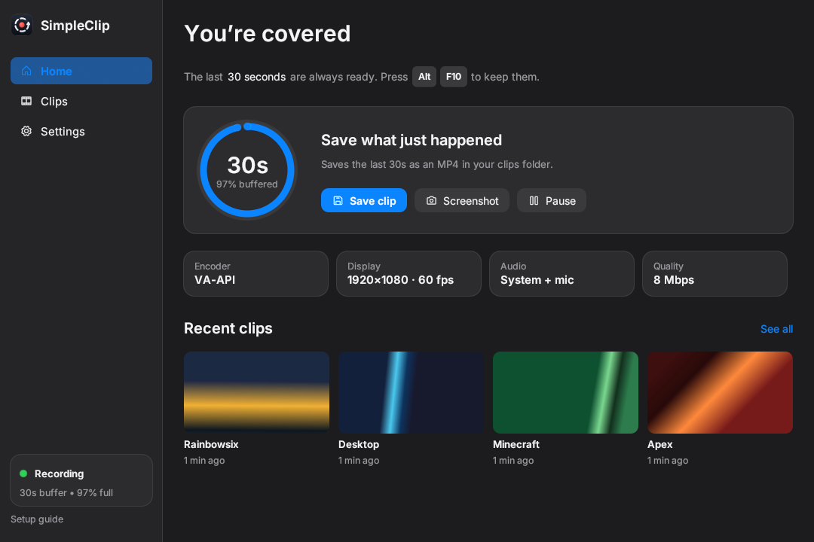

### Clips

Grouped by game (the default):

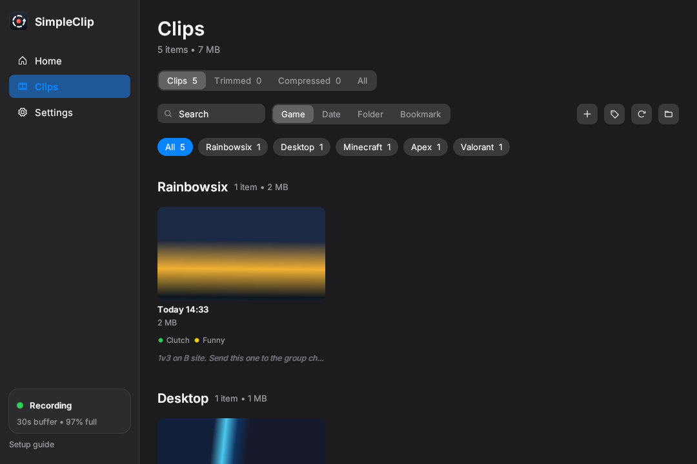

Grouped by bookmark:

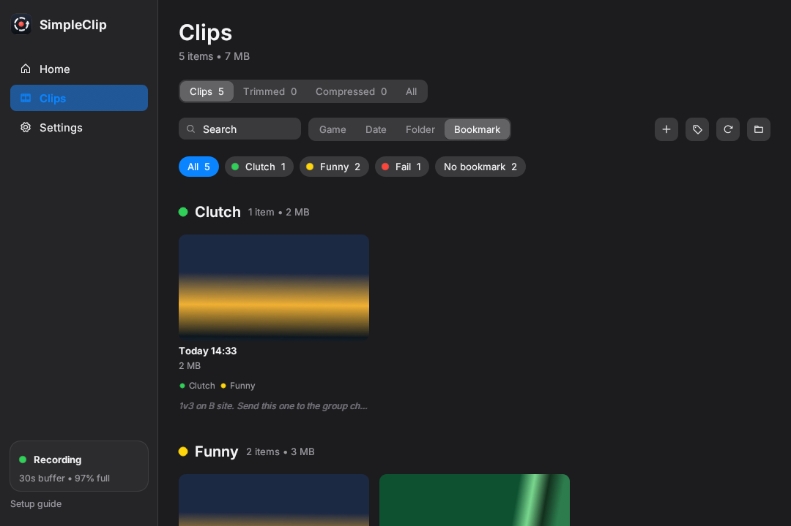

Grouped by folder:

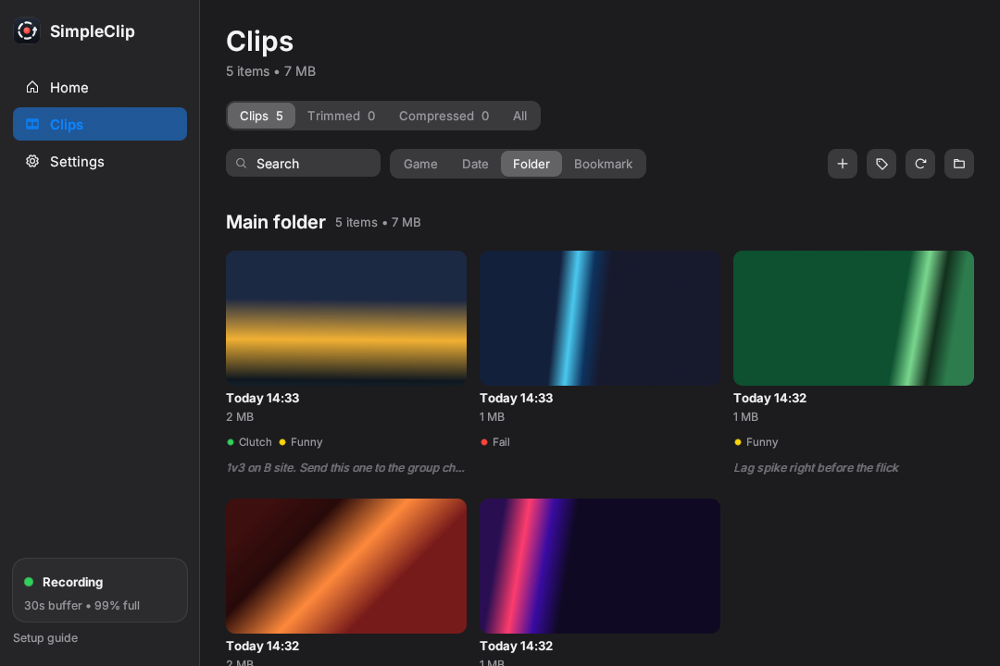

Trimmed clips only:

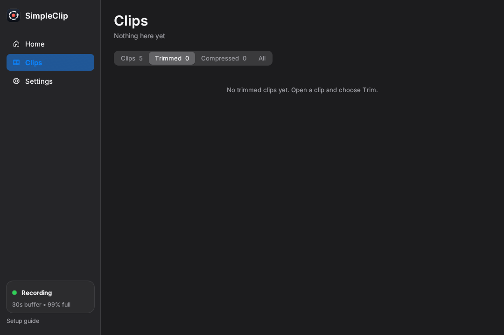

### Sharing

After saving a trim, SimpleClip asks what you want to do with it. You can turn the prompt off in
Settings.

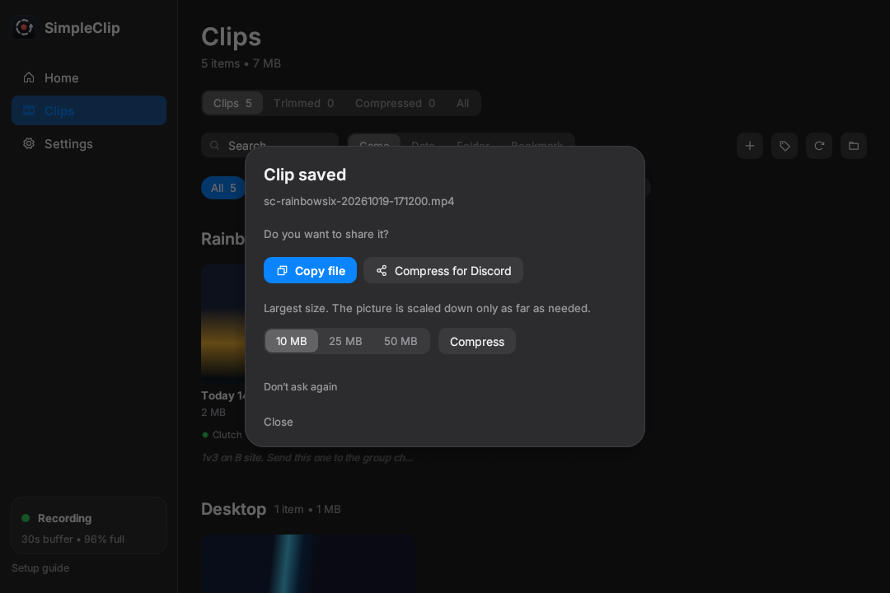

Compressed copies are listed apart from your clips, next to the Trimmed ones:

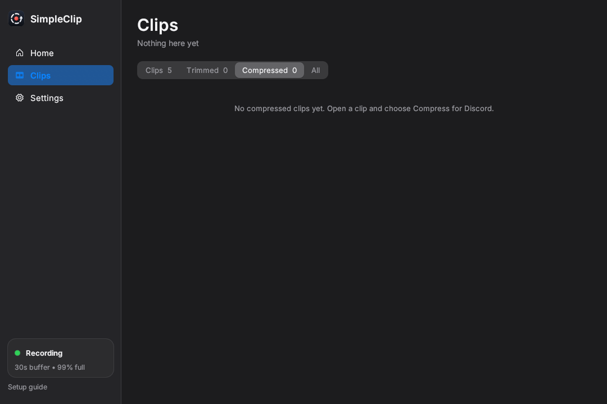

### Clip details

Rename, move to a folder, add bookmarks, write a note. The buttons on the left include Copy file and
Compress for Discord.

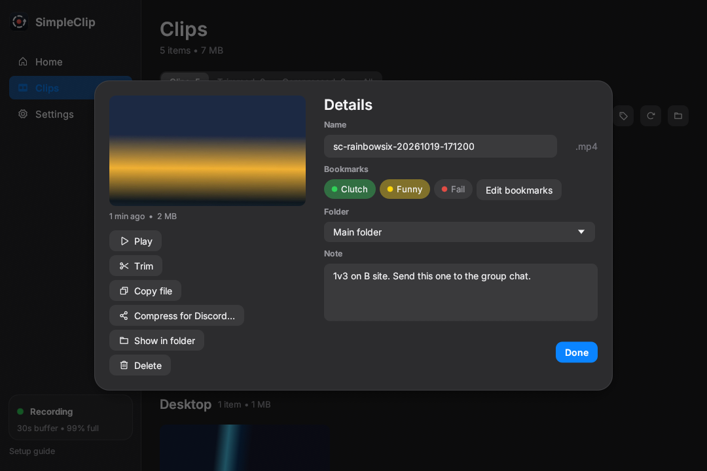

Create and recolour bookmarks:

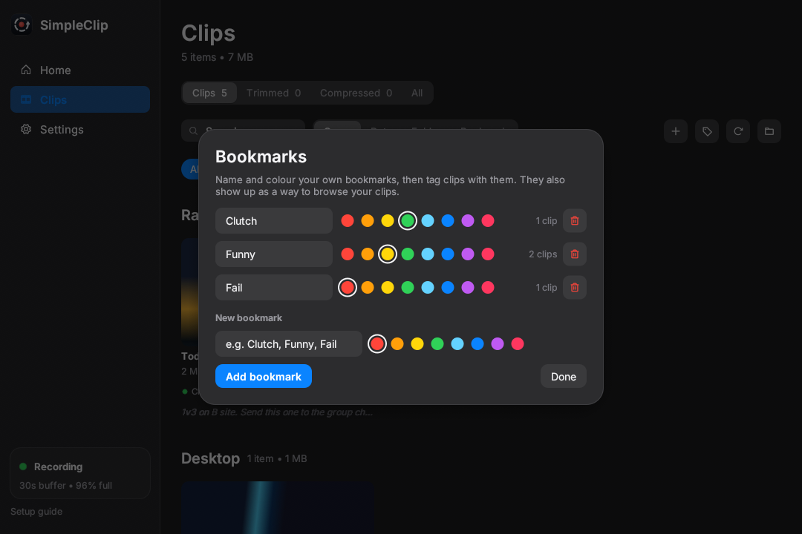

### Trim

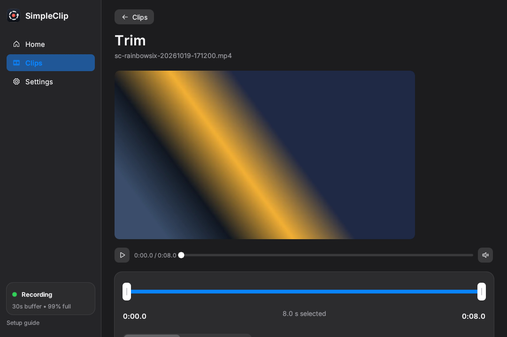

### Settings

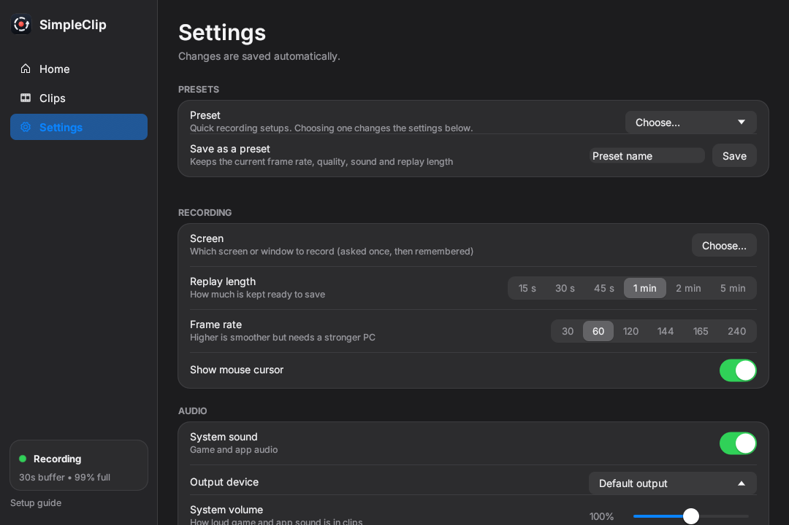

### Save card

The detailed card (the default), and the minimal one:

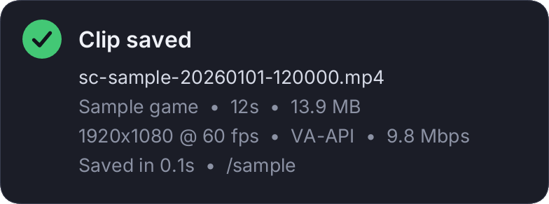


### First run

A short setup guide appears the first time you open the app.

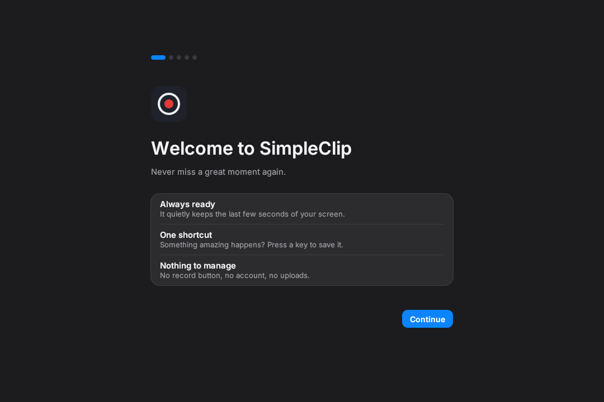

There is also a light theme. It follows your desktop setting.


</details>

## Requirements

- A Wayland session with **PipeWire** and **xdg-desktop-portal** (with a ScreenCast backend for your
  compositor: `xdg-desktop-portal-hyprland`, `-gnome`, `-kde`, `-wlr`, `-cosmic`).
- A GPU with VA-API H.264 encode (AMD, Intel) or NVENC (NVIDIA). Without one it falls back to x264 on
  the CPU, which works but costs CPU.
- FFmpeg 9 libraries. `ffmpeg-next` has to match the FFmpeg major version, so on a distro that is still
  on FFmpeg 7 or 8, change the version in the workspace `Cargo.toml` to match.
- For the shortcuts: Hyprland, or a desktop with the GlobalShortcuts portal (KDE, GNOME 48+, COSMIC).
  On anything else, bind a key to `sc save` (and `sc screenshot`, `sc open`) in the compositor.
- A tray host for the tray icon (KDE, waybar, or GNOME with the AppIndicator extension). Without one
  everything still works, there is just no icon.
- For the save card: a compositor with `wlr-layer-shell` (Hyprland, sway, KDE, COSMIC and most others).
  GNOME falls back to a desktop notification.
- Optional: `wl-clipboard` or `xclip` (Copy file), `pw-play` or `paplay` (the save sound).

## Install

```
git clone https://github.com/whoevenisxeno/simpleclip-linux
cd simpleclip-linux
./packaging/install.sh
```

This builds the release binaries and installs `scd`, `sc` and `sc-gui` to `~/.local/bin`, a launcher and
icon, and an uninstaller. It never asks for root. Then open **SimpleClip** from your launcher, or run
`sc-gui`. The first launch starts the daemon and your desktop asks which screen to share, once.

Uninstalling: `~/.local/share/simpleclip/uninstall.sh`, or the Uninstall button at the bottom of
Settings. Your clips are never touched by the uninstaller.

Clips go to `~/Videos/SimpleClip`, in a folder per day by default. Settings are in
`~/.config/simpleclip/config.toml`, the clip library (bookmarks, notes) is in
`~/.local/share/simpleclip/library.json`, and logs are in `~/.local/share/simpleclip/logs`.

### Starting at login

On by default (Settings > General > Open at login). On Hyprland the managed snippet starts the daemon
with an `exec-once`; elsewhere an XDG autostart entry does. If your session does not run XDG autostart
entries, use the systemd unit instead:

```
mkdir -p ~/.config/systemd/user
cp packaging/systemd/simpleclip.service ~/.config/systemd/user/
systemctl --user enable --now simpleclip.service
```

## The command line

The `sc` command talks to the running daemon. Example output:

```
> sc status
state:     Active
recording: false
buffer:    30s (98% full)
monitor:   captured display (1920x1080)
encoder:   Vaapi
drift:     0.0 ms
daemon:    v1.0.0

> sc save
saved /home/you/Videos/SimpleClip/2026-10-26/sc-valorant-20261026-143735.mp4 (11.9s)

> sc screenshot
saved /home/you/Videos/SimpleClip/2026-10-26/sc-valorant-20261026-143801.png (0.0s)

> sc trim <clip> --start 2 --end 6
saved .../sc-valorant-20261026-143735-trim.mp4 (4.0s)

> sc compress <clip> --mb 10
saved .../sc-valorant-20261026-143735-10mb.mp4 (11.9s)
```

Other commands: `pause`, `resume`, `open`, `choose-screen`, `quit`, `audio-devices`, `thumbnail`,
`test-notification`.

## Default config

This is what a fresh install writes (printed by the code itself, not typed by hand):

```toml
[capture]
monitor-id = ""               # unused: the screen is chosen in the share dialog
show-cursor = true
target-fps = 60

[audio]
desktop-enabled = true
desktop-device = ""           # a PipeWire sink name (see `sc audio-devices`); empty is the default
mic-enabled = true
tracks = "mixed"
desktop-volume = 100          # percent, 0 to 200
mic-volume = 100

[buffer]
replay-duration-secs = 30
ram-cap-mb = 2048

[encode]
codec = "h264"
bitrate-kbps = 8000
gop-frames = 120
gpu-convert = true            # NVENC only: let the GPU convert colours

[save]
filename-template = "sc-{app}-{date}"
folder-policy = "per-day"
container = "mp4"
warn-at-gb = 50

[hotkeys]
save = "ALT+F10"
screenshot = "ALT+F9"
open = "ALT+F8"               # brings the SimpleClip window up; empty turns it off

[general]
autostart = true
setup-complete = false
popup-style = "detailed"      # or "minimal"
popup-position = "top-right"  # top-left, bottom-right, bottom-left, center
popup-animation = true
theme = "system"              # or midnight, graphite, ember, forest, violet, rose, ocean, daylight, sand, mint
# accent = "#8b5cf6"          # optional accent colour over any theme
save-sound = true
discord-presence = true
# save-sound-file = '/path/to/your.wav'
```

## Typical numbers

On the machine it was built on (RX 6650 XT, Hyprland, PipeWire) at the defaults (1920x1080, 60 fps,
8 Mbps H.264 through VA-API) the pacer delivers 60 frames a second with none dropped, the encoder takes
about a millisecond a frame, a save takes about a tenth of a second, and a clip is about 60 MB per minute
of video. With software x264 the encode is about 4 ms a frame. I have not benchmarked whole-system
overhead, so I won't put a number on it.

## Things that are not finished

Being straight about this so you don't hit it by surprise:

- **Only H.264 in MP4.** The config has `container` and `codec` fields, but MKV, HEVC and AV1 are not
  implemented yet.
- **Tested on one setup.** Everything above was run on Hyprland with an AMD GPU. The NVENC path, the
  KDE and GNOME shortcut portal, sway's foreground-window lookup, X11 clipboard (`xclip`) and the
  layer-shell card on other compositors are written but have not been run on real systems.
- **The screen is chosen in your desktop's dialog**, not inside the app, and there is no list of
  displays. Settings > Recording > Screen > Choose asks again.
- **A shortcut your compositor already owns can't be recorded in the app**, because the compositor
  never passes that key on. Type it in `config.toml`, or pick a free one.
- **Game names for the clip file and the Discord status need Hyprland or sway**, the only compositors
  that can say what window is in front. Elsewhere clips are named without a game.
- **`warn-at-gb` and `post_save_hook` are in the config but do nothing.**
- **`ram-cap-mb` is only used to estimate and validate the buffer size**, it is not a hard limit.
- **Trim cuts on keyframes.** That is the price of not re-encoding. With the default 2 second
  keyframe spacing at 60 fps, cuts can land up to about 2 seconds off.
- **No prebuilt packages yet** (AUR, AppImage). Release tarballs are built against current Arch.

## Build from source

You need Rust (stable), clang (for bindgen) and the development files for FFmpeg, PipeWire, ALSA and
libva. On Arch:

```
sudo pacman -S --needed rust clang pkgconf ffmpeg libpipewire alsa-lib libva
```

Then `./packaging/install.sh`, or just `cargo build --release`. Checks:

```
cargo clippy --workspace --all-targets
cargo test --workspace
```

## How it is put together

```
sc-core     config, the IPC messages, the ring buffer
sc-capture  the screen through the portal and PipeWire, desktop audio, the microphone
sc-ffmpeg   encoders, muxing, trim, thumbnails (FFmpeg through ffmpeg-next)
scd         the background service: pipeline, tray, shortcuts, save card, IPC server
sc          the command line client
sc-gui      the app (egui)
```

The service and the clients talk over a local socket, `simpleclip.sock`, using one JSON message per line.
The app asks the service for previews and trims, because the service is the one that owns FFmpeg.
[ARCHITECTURE.md](ARCHITECTURE.md) has the picture, and [docs/DECISIONS.md](docs/DECISIONS.md) has the
reasoning behind the choices.

## Origin and licence

This is the Windows app brought to Linux. An earlier, plainer Linux-only SimpleClip
([whoevenisxeno/SimpleClip](https://github.com/whoevenisxeno/SimpleClip)) came first; this one replaces
it. Licensed under the MIT licence, see [LICENSE](LICENSE). The bundled fonts are Inter (SIL OFL, see
`assets/fonts/Inter-LICENSE.txt`) and Phosphor icons (MIT). FFmpeg is a separate project under its own
licence.
